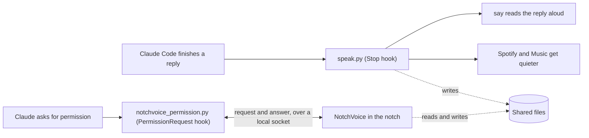

<div align="center">


# NotchVoice

**Claude Code, out loud. Right in your MacBook's notch.**

Hear every Claude Code reply spoken aloud, and allow or deny Claude's requests right from the notch. The notch glows while Claude talks, and hovering over it brings up the controls.

[](#install)
[](Package.swift)
[](https://claude.com/claude-code)
[](#how-it-works)

</div>

## Features

- **Spoken replies.** Claude Code reads each reply aloud as soon as it finishes. Speech runs fully offline through macOS `say`, with markdown tidied up and code blocks skipped.
- **A notch that glows.** A soft, shifting glow surrounds the notch while Claude talks.
- **Music steps aside.** Spotify and Apple Music get quieter while Claude speaks, then return to the volume they were at.
- **Controls in the notch.** Hover over the notch to turn voice replies on or off, or set a keyboard shortcut for it. Turning them off mid-sentence stops the speech straight away.
- **Permissions in the notch.** When Claude asks to run a command or edit a file, the notch shows the request with Allow and Deny.
- **Settings in one click.** The cog next to the switch opens settings for the voice, speaking speed, music volume and glow theme.
- **Stays out of the way.** No Dock icon and no menu bar item. It uses almost no CPU while idle, and it opens at login.

<table>
  <tr>
    <td width="50%"></td>
    <td width="50%"></td>
  </tr>
  <tr>
    <td align="center"><b>Glows while Claude speaks</b></td>
    <td align="center"><b>Off with one click</b></td>
  </tr>
</table>

## Permissions

When Claude Code needs your permission, the notch opens on its own and shows what Claude wants to do and in which project. For a command it shows the exact command, and for a file edit the lines being changed. Click **Allow** or **Deny**.

<p align="center">
  
</p>

- **Claude's prompt still works.** You can answer in the notch or in Claude Code, whichever is closer. The first answer counts, and the notch clears itself when you answer in Claude.
- **It only appears when Claude asks.** Commands you've already allowed, and modes that don't ask, such as auto mode, never reach the notch.
- **Several at once.** Requests from other sessions or agents queue up, and the card shows how many more are waiting.
- **Not now?** Click ✕ to dismiss the card and answer in Claude instead. To turn the feature off, use **Ask for permission in the notch** in settings.

Questions Claude asks you, and plan approvals, stay in Claude Code because they need more than a yes or no.

## Mute shortcut

Set a keyboard shortcut once, then press it anywhere to turn voice replies on or off, even while another app is in front. The notch opens for a moment so you can see which way it went, and muting mid-reply stops the speech straight away.

<p align="center">
  
</p>

To set it, open settings, click **Record** next to **Mute shortcut**, and press the keys you want. The shortcut needs at least one of ⌘, ⌥ or ⌃. Press Esc to cancel, and click ✕ to remove the shortcut. It doesn't need any extra macOS permissions.

<p align="center">
  
</p>

## Settings

Click the cog in the notch to open settings. Changes apply to the next reply, with no restart needed.

<p align="center">
  
</p>

- **Voice.** Choose any macOS voice installed on your Mac. You hear a short sample as soon as you pick one.
- **Speed.** Set how fast replies are read, from 0.6× to 2×.
- **Music volume.** Choose how loud Spotify and Apple Music stay while Claude speaks, from silent to unchanged.
- **Glow.** Choose from six colour themes. The notch lights up briefly to preview the one you pick.
- **Permissions.** Turn permission requests in the notch on or off.
- **Mute shortcut.** Set a keyboard shortcut that turns voice replies on or off from anywhere.

<p align="center">
  
</p>

## Install

You need macOS 14 or later, [Claude Code](https://claude.com/claude-code), and Xcode or the Command Line Tools (`xcode-select --install`).

```bash
git clone https://github.com/NCSmit/notch-voice.git
cd notch-voice
./install.sh
```

Then restart Claude Code and hover over the notch.

> [!TIP]
> The first time Claude speaks while Spotify or Music is open, macOS asks whether it may control that app. Allow it, so the music can get quieter.

The installer does four things:

1. It copies the two hooks to `~/.claude/hooks/`: `speak.py` for voice replies and `notchvoice_permission.py` for permission requests. An existing file with the same name is saved with a `.bak` extension first.
2. It adds them to `~/.claude/settings.json` as a `Stop` hook and a `PermissionRequest` hook, and keeps a backup of that file.
3. It builds the app on your Mac and puts it in `~/Applications`. Because the app is built locally, macOS doesn't show a security warning.
4. It starts the app, which then opens at login.

On a Mac without a notch, the panel sits at the top center of the screen instead.

## How it works



The Stop hook does the speaking. The app gives you the controls and the glow. They share three small files:

| File | Written by | Used for |
| --- | --- | --- |
| `~/.claude/tts_off` | The switch | While this file exists, the hook stays silent. |
| `~/.claude/tts_settings.json` | The settings window | Holds `voice`, `rate` (words per minute) and `duck` (how loud the music stays, from 0 to 1). The hook passes the voice and rate to `say`. |
| `$TMPDIR/claude_tts_owner` | The hook | Holds `<hook pid> <say pid>` while a reply is spoken. The glow follows this file. |

The permission hook sends each request to the app over a Unix socket at `$TMPDIR/notchvoice.sock`, then prints the app's answer as the hook's decision. Claude Code shows its own prompt at the same time. If you answer there first, the hook sees the result in the session transcript and withdraws the card. If the app isn't running, the hook exits straight away, and Claude Code asks as usual.

Right-click the panel for **Settings…** and **Quit**.

## Configuration

The settings window covers everything you need day to day. If you use the hook without the app, set these in the `env` block of `~/.claude/settings.json`. Anything you choose in the settings window takes priority over them.

| Variable | Default | What it does |
| --- | --- | --- |
| `CLAUDE_TTS_VOICE` | System voice | The voice to use. |
| `CLAUDE_TTS_RATE` | The voice's own rate | Speaking rate, in words per minute. |
| `CLAUDE_TTS_DUCK` | `0.5` | How loud the music stays while Claude speaks, as a fraction of its volume. |

## Uninstall

```bash
./install.sh --uninstall
```

This removes the app, its login item, both hooks, and their entries in `settings.json`.

## Troubleshooting

<details>
<summary><b>Claude doesn't speak</b></summary>

- Restart Claude Code after installing. Hooks are loaded when a session starts.
- Hover over the notch and check that voice replies are on.
- Run `say hello` in Terminal to check that your Mac can speak.

</details>

<details>
<summary><b>The music doesn't get quieter</b></summary>

Open System Settings → Privacy & Security → Automation. Allow Claude Code, or your terminal app, to control Spotify and Music.

</details>

<details>
<summary><b>Permission requests don't show in the notch</b></summary>

- Restart Claude Code after installing, so it loads the new hook.
- Check that **Ask for permission in the notch** is on in settings.
- Remember that the notch only shows requests Claude actually asks about. In auto mode, or for commands you've already allowed, Claude doesn't ask.

</details>

<details>
<summary><b>I want better voices</b></summary>

Download Premium or Enhanced voices in System Settings → Accessibility → Spoken Content → System Voice → Manage Voices. Then reopen NotchVoice's settings, and they're in the voice list.

</details>
