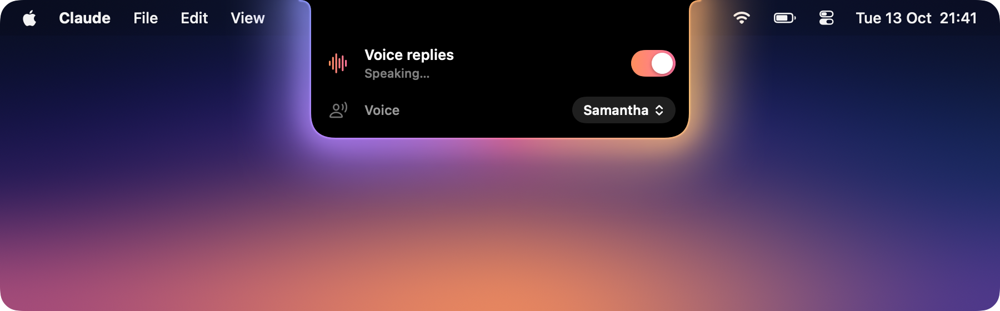
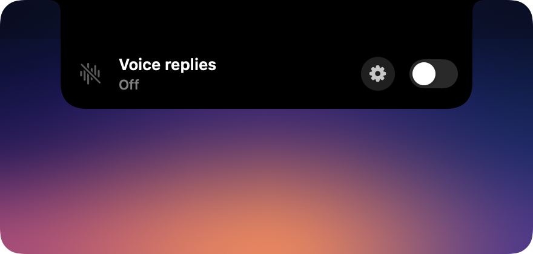
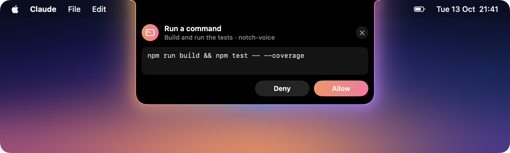
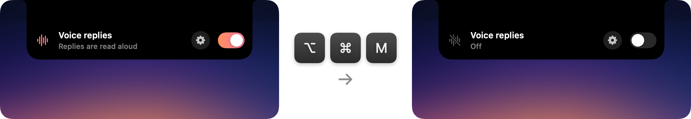
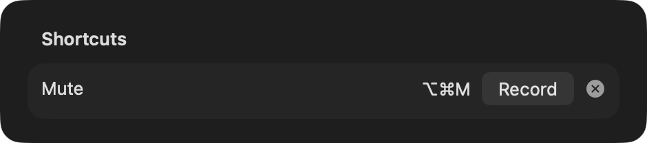
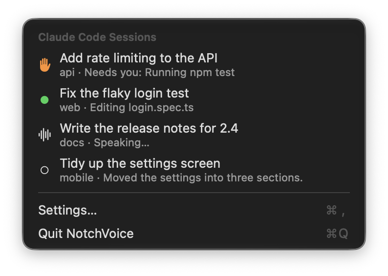
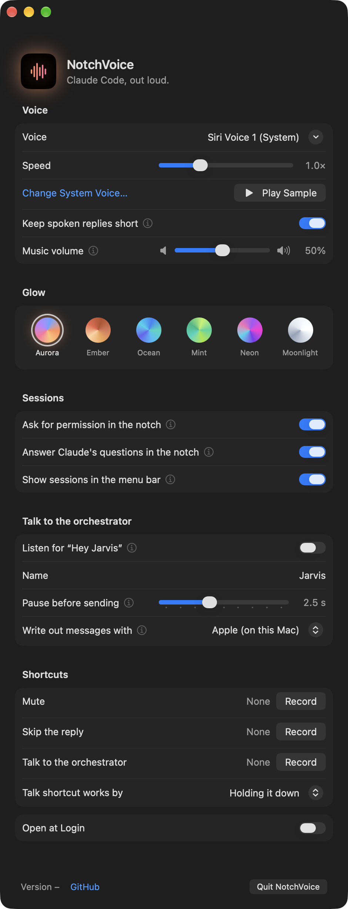
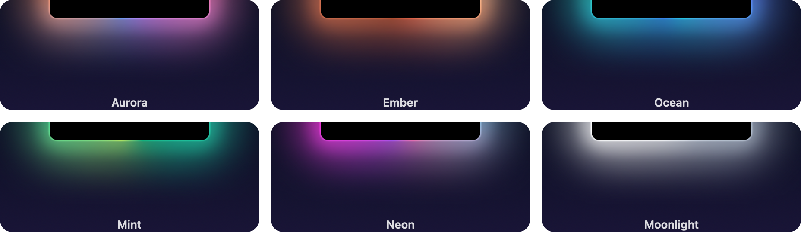
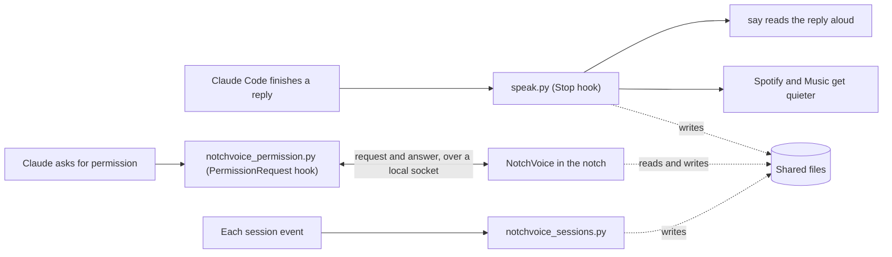

<div align="center">



# NotchVoice

**Claude Code, out loud. Right in your MacBook's notch.**

Hear every Claude Code reply spoken aloud, and allow or deny Claude's requests right from the notch. The notch glows while Claude talks, and hovering over it brings up the controls.

[](#install)
[](Package.swift)
[](https://claude.com/claude-code)
[](#how-it-works)
[](https://github.com/NCSmit/notch-voice/actions/workflows/ci.yml)

</div>

## Features

- **Spoken replies.** Claude Code reads each reply aloud as soon as it finishes. Speech runs fully offline through macOS `say`, with markdown tidied up and code blocks skipped.
- **A notch that glows.** A soft, shifting glow surrounds the notch while Claude talks.
- **Short spoken replies.** While voice replies are on, Claude is reminded with every prompt to answer in a few sentences, so replies are quick to listen to.
- **Never talks over you.** While you dictate with Wispr Flow, a reply that's speaking pauses and picks up where it left off when you stop. New replies wait until you're done.
- **Music steps aside.** Spotify and Apple Music get quieter while Claude speaks, then return to the volume they were at.
- **Controls in the notch.** Hover over the notch to turn voice replies on or off, or set a keyboard shortcut for it. Turning them off mid-sentence stops the speech straight away.
- **Permissions in the notch.** When Claude asks to run a command or edit a file, the notch shows the request with Allow and Deny.
- **Sessions in the menu bar.** A menu bar icon lists your open Claude Code sessions and what each one is doing. Click one to go straight to it.
- **An orchestrator.** Type `/orchestrator` in one session and it becomes the single voice over all the others: it briefs you, tells you when a session needs you, and passes your instructions on.
- **Regular chats too.** Chats in the Claude desktop app can be read aloud as well, through a small local speak tool.
- **Settings in one click.** The cog next to the switch opens settings for the voice, speaking speed, music volume and glow theme.
- **Stays out of the way.** No Dock icon, and you can hide the menu bar icon. It uses almost no CPU while idle, and it opens at login.

<table>
  <tr>
    <td width="50%"></td>
    <td width="50%"></td>
  </tr>
  <tr>
    <td align="center"><b>Glows while Claude speaks</b></td>
    <td align="center"><b>Off with one click</b></td>
  </tr>
</table>

## Permissions

When Claude Code needs your permission, the notch opens on its own and shows what Claude wants to do and in which project. For a command it shows the exact command, and for a file edit the lines being changed. Click **Allow** or **Deny**.

<p align="center">
  
</p>

- **Claude's prompt still works.** You can answer in the notch or in Claude Code, whichever is closer. The first answer counts, and the notch clears itself when you answer in Claude.
- **It only appears when Claude asks.** Commands you've already allowed, and modes that don't ask, such as auto mode, never reach the notch.
- **Several at once.** Requests from other sessions or agents queue up, and the card shows how many more are waiting.
- **Not now?** Click ✕ to dismiss the card and answer in Claude instead. To turn the feature off, use **Ask for permission in the notch** in settings.

Questions Claude asks you, and plan approvals, stay in Claude Code because they need more than a yes or no.

## Mute shortcut

Set a keyboard shortcut once, then press it anywhere to turn voice replies on or off, even while another app is in front. The notch opens for a moment so you can see which way it went, and muting mid-reply stops the speech straight away.

<p align="center">
  
</p>

To set it, open settings, click **Record** next to **Mute shortcut**, and press the keys you want. The shortcut needs at least one of ⌘, ⌥ or ⌃. Press Esc to cancel, and click ✕ to remove the shortcut. It doesn't need any extra macOS permissions.

<p align="center">
  
</p>

## Sessions

The menu bar icon lists every Claude Code session that's open on your Mac, in the terminal, the Claude desktop app or an IDE. Each one shows its name, the one Claude Code or the desktop app gives it (or else its first prompt), its project, and what it's doing right now.

<p align="center">
  
</p>

- **What needs you comes first.** A session waiting for a permission, a question or a plan approval moves to the top with an orange hand, and the menu bar icon shows how many are waiting. The rest stay in the order they started, so they don't jump around.
- **Click to go there.** Clicking a session brings it forward. A session in the Claude desktop app opens right in the app. In Terminal and iTerm2, the session's own tab is selected; the first time, macOS asks whether NotchVoice may control that app.
- **Always current.** A green dot means Claude is working, a waveform means its reply is being read aloud, and an empty circle means it's finished. A session leaves the list when you close it.

A session that was already open when you installed NotchVoice may only appear after you restart it. To hide the icon, turn off **Show sessions in the menu bar** in settings.

## Orchestrator

Type `/orchestrator` in any Claude Code session to make it your orchestrator, the one voice over all your other sessions. It catches up on every open session and gives you a short spoken briefing. Then it keeps watching, and tells you as soon as a session finishes or needs you.

- **One voice.** While a session is the orchestrator, NotchVoice reads only its replies aloud, and the other sessions keep working quietly. The orchestrator sits at the top of the menu with a crown. Click **Let Every Session Speak** to hear every session again, or just close the orchestrator.
- **Passes your instructions on.** Say "tell the login session to run the tests", and it sends the message to that session. Where Claude Code can't message other sessions, it gives you the text to paste instead. It asks before passing on anything that changes a session's direction.
- **Keeps context healthy.** When a long session's context is nearly full, it asks that session to save its working state first. After the next compaction, NotchVoice hands that state back to the session, so nothing gets lost.
- **Knows your pull requests.** It tells you how each session's pull request is doing: checks passing or failing, changes requested, merged. For sessions in the Claude desktop app it asks the app, which already keeps track. For other sessions it asks GitHub with the `gh` command, once per session and only while it briefs you.
- **Learns how you work.** On request, it looks through your recent prompts for corrections you keep making, and suggests notes for Claude's memory. You can say no to any of them.

The orchestrator reads your sessions' transcripts the way any Claude Code session can. Its helper redacts obvious secrets, such as API keys, before passing anything on.

The first time, Claude Code asks before the orchestrator runs its helper and before it writes its notes in `~/.claude/orchestrator/`. Allow both for good, so a briefing isn't held up by a prompt you can't see. NotchVoice doesn't allow these for you, because then any session could write notes that the orchestrator trusts.

## Regular Claude chats

Chats in the Claude desktop app can be read aloud too. The installer adds a small local tool called `speak` to the desktop app, and NotchVoice asks Claude to call it at the end of each reply with a short spoken summary. It uses the same voice, glow, music ducking and mute switch as Claude Code.

1. Quit the Claude desktop app and open it again after installing, so it loads the tool.
2. The first time Claude speaks in a chat, the app asks whether NotchVoice may use the tool. Choose to always allow it.
3. If Claude doesn't call the tool on its own, add this line to your personal preferences in Claude's settings: "At the end of every reply, call the NotchVoice speak tool with a one to three sentence spoken summary."

This works in the Claude desktop app only. The claude.ai website and the mobile apps can't run local tools.

## Settings

Click the cog in the notch to open settings. Changes apply to the next reply, with no restart needed.

<p align="center">
  
</p>

- **Voice.** By default NotchVoice uses your Mac's own spoken content voice, and the menu shows its name, for example "Siri Voice 1 (System)". **Change System Voice…** opens the Spoken Content page in System Settings, where that voice is chosen. You can also choose any other installed macOS voice, and you hear a short sample as soon as you pick one.
- **Speed.** Set how fast replies are read, from 0.6× to 2×.
- **Short replies.** Turn the "keep spoken replies short" reminder on or off. It's on by default.
- **Music volume.** Choose how loud Spotify and Apple Music stay while Claude speaks, from silent to unchanged.
- **Glow.** Choose from six colour themes. The notch lights up briefly to preview the one you pick.
- **Permissions.** Turn permission requests in the notch on or off.
- **Sessions.** Show or hide your sessions in the menu bar.
- **Mute shortcut.** Set a keyboard shortcut that turns voice replies on or off from anywhere.

<p align="center">
  
</p>

## Install

You need macOS 14 or later, [Claude Code](https://claude.com/claude-code), and Xcode or the Command Line Tools (`xcode-select --install`).

```bash
git clone https://github.com/NCSmit/notch-voice.git
cd notch-voice
./install.sh
```

Then restart Claude Code and hover over the notch.

NotchVoice works wherever Claude Code runs on your Mac: in the terminal, in the Code tab of the Claude desktop app, and in IDE extensions. Chats in the Claude desktop app work too, through a speak tool (see [Regular Claude chats](#regular-claude-chats)). You don't need to turn on any speech or dictation settings, because NotchVoice uses the voices built into macOS.

> [!TIP]
> The first time Claude speaks while Spotify or Music is open, macOS asks whether it may control that app. Allow it, so the music can get quieter.

The installer does six things:

1. It copies five hooks to `~/.claude/hooks/`: `speak.py` for voice replies, `notchvoice_permission.py` for permission requests, `notchvoice_brief.py` for short spoken replies, `notchvoice_sessions.py` for the sessions in the menu bar, and `notchvoice_handoff.py`, which hands saved working state back after a compaction. The speak tool for desktop chats, `notchvoice_mcp.py`, and the orchestrator's helper, `notchvoice_snapshot.py`, go there too. An existing file with the same name is saved with a `.bak` extension first.
2. It adds the hooks to `~/.claude/settings.json`, and keeps a backup of that file. It also denies the desktop speak tool there, so Claude Code doesn't read its replies twice.
3. It installs the `/orchestrator` skill in `~/.claude/skills/orchestrator/`.
4. It builds the app on your Mac and puts it in `~/Applications`. Because the app is built locally, macOS doesn't show a security warning.
5. It starts the app, which then opens at login.
6. If the Claude desktop app is installed, it adds the speak tool to the app's `claude_desktop_config.json` and keeps a backup of that file. The desktop app rewrites that file while it's open, so if it's open, the installer makes the change again as soon as you quit it.

On a Mac without a notch, the panel sits at the top center of the screen instead.

## How it works



The Stop hook does the speaking. The app gives you the controls, the glow and the session list. They share these files:

| File | Written by | Used for |
| --- | --- | --- |
| `~/.claude/tts_off` | The switch | While this file exists, the hook stays silent. |
| `~/.claude/tts_settings.json` | The settings window | Holds `voice`, `rate` (words per minute), `duck` (how loud the music stays, from 0 to 1) and `brief` (the short-replies reminder). The Stop hook passes the voice and rate to `say`. |
| `$TMPDIR/claude_tts_owner` | The hook | Holds `<hook pid> <say pid>` while a reply is spoken. The glow follows this file. |
| `$TMPDIR/claude_tts_session` | The hook | Holds `<hook pid> <session id>` while a reply is spoken, so the menu can mark that session. The app only trusts it while the hook pid matches the owner file. |
| `$TMPDIR/notchvoice_dictating` | The app | Kept fresh while a dictation app uses the microphone. The Stop hook holds new replies back and pauses the one speaking while it's fresh, and treats it as gone once it's 5 seconds old, so speech never stays stuck if the app quits. |
| `~/.claude/notchvoice/sessions/<session id>.json` | The sessions hook | One status file per session: its state, title, project, current activity, and the process, app and terminal it runs in. The menu bar lists these. |
| `~/.claude/notchvoice/orchestrator.json` | The orchestrator | Names the session that ran `/orchestrator`. While that session is open, the Stop hook speaks only its replies. **Let Every Session Speak** deletes this file. |
| `~/.claude/notchvoice/handoffs/<session id>.md` | A session the orchestrator asked | Working state saved before a compaction. The handoff hook hands it back once, after the next compaction, then renames it to `.restored.md`. |

`$TMPDIR` here is your Mac's own temporary folder. The hooks look it up from macOS, because tools started by the Claude desktop app don't get the variable.

In the desktop app's chats, Claude calls the `speak` tool from `notchvoice_mcp.py`, a small MCP server that runs `speak.py` with the text. Claude Code must not use it, because the `Stop` hook already speaks there. The desktop app shares its tools with its Code sessions, so the installer denies `mcp__notchvoice__speak` in `settings.json`.

The `UserPromptSubmit` hook adds a one-line reminder to each prompt while voice replies are on and `brief` isn't turned off. The reminder asks Claude to keep its final answer to a few spoken sentences.

The sessions hook runs, without making Claude wait, on `SessionStart`, `UserPromptSubmit`, `PreToolUse`, `PostToolUse`, `PermissionRequest`, `Stop` and `SessionEnd`, and rewrites the session's status file each time. The handoff hook runs only on `SessionStart` after a compaction, and Claude waits for it, so the saved working state arrives before Claude carries on. The app lists a session for as long as its Claude Code process is running. No hook runs when you interrupt Claude with Esc, so the app also checks the end of a working session's transcript for Claude Code's interrupt note. Session names and desktop app ids come from Claude Code's own record of each running session in `~/.claude/sessions/`, which NotchVoice only reads.

The permission hook sends each request to the app over a Unix socket at `$TMPDIR/notchvoice.sock`, then prints the app's answer as the hook's decision. Claude Code shows its own prompt at the same time. If you answer there first, the hook sees the result in the session transcript and withdraws the card. If the app isn't running, the hook exits straight away, and Claude Code asks as usual.

Right-click the panel, or click the menu bar icon, for **Settings…** and **Quit**.

## Configuration

The settings window covers everything you need day to day. If you use the hook without the app, set these in the `env` block of `~/.claude/settings.json`. Anything you choose in the settings window takes priority over them.

| Variable | Default | What it does |
| --- | --- | --- |
| `CLAUDE_TTS_VOICE` | System voice | The voice to use. |
| `CLAUDE_TTS_RATE` | The voice's own rate | Speaking rate, in words per minute. |
| `CLAUDE_TTS_DUCK` | `0.5` | How loud the music stays while Claude speaks, as a fraction of its volume. |

## Uninstall

```bash
./install.sh --uninstall
```

This removes the app, its login item, the hooks, the speak tool, the `/orchestrator` skill, the session status files and saved working state, and their entries in `settings.json` and the desktop app's config.

## Troubleshooting

<details>
<summary><b>Claude doesn't speak</b></summary>

- Restart Claude Code after installing. Hooks are loaded when a session starts.
- Hover over the notch and check that voice replies are on.
- Run `say hello` in Terminal to check that your Mac can speak.

</details>

<details>
<summary><b>Chats in the Claude desktop app aren't read aloud</b></summary>

- Quit the Claude desktop app and open it again. It loads the speak tool when it starts.
- When Claude first asks to use the NotchVoice speak tool, choose to always allow it.
- If Claude doesn't call the tool, add the line from [Regular Claude chats](#regular-claude-chats) to your personal preferences.
- If none of that helps, run `./install.sh` again, then quit and reopen the desktop app.

</details>

<details>
<summary><b>The music doesn't get quieter</b></summary>

Open System Settings → Privacy & Security → Automation. Allow Claude Code, or your terminal app, to control Spotify and Music.

</details>

<details>
<summary><b>Permission requests don't show in the notch</b></summary>

- Restart Claude Code after installing, so it loads the new hook.
- Check that **Ask for permission in the notch** is on in settings.
- Remember that the notch only shows requests Claude actually asks about. In auto mode, or for commands you've already allowed, Claude doesn't ask.

</details>

<details>
<summary><b>Sessions are missing from the menu bar</b></summary>

- Restart Claude Code after installing. Sessions only report to NotchVoice once they've loaded the new hook.
- Check that **Show sessions in the menu bar** is on in settings.
- If the icon is hidden behind the notch, quit a few other menu bar apps, or hold ⌘ and drag the icon to the right.

</details>

<details>
<summary><b>Clicking a session doesn't select its tab</b></summary>

Open System Settings → Privacy & Security → Automation, and allow NotchVoice to control Terminal or iTerm2. Without that, clicking a session still brings its app forward.

</details>

<details>
<summary><b>I want better voices</b></summary>

Download Premium or Enhanced voices in System Settings → Accessibility → Spoken Content → System Voice → Manage Voices. Then reopen NotchVoice's settings, and they're in the voice list.

To use a Siri voice, click **Change System Voice…** in NotchVoice settings, pick the Siri voice as the system voice there, and leave NotchVoice on its system voice option. macOS only lets apps use Siri voices as the system voice.

</details>

## Contributing

Contributions are welcome. [CONTRIBUTING.md](CONTRIBUTING.md) explains how the pieces fit together, how to build and test, and how to open a pull request.
